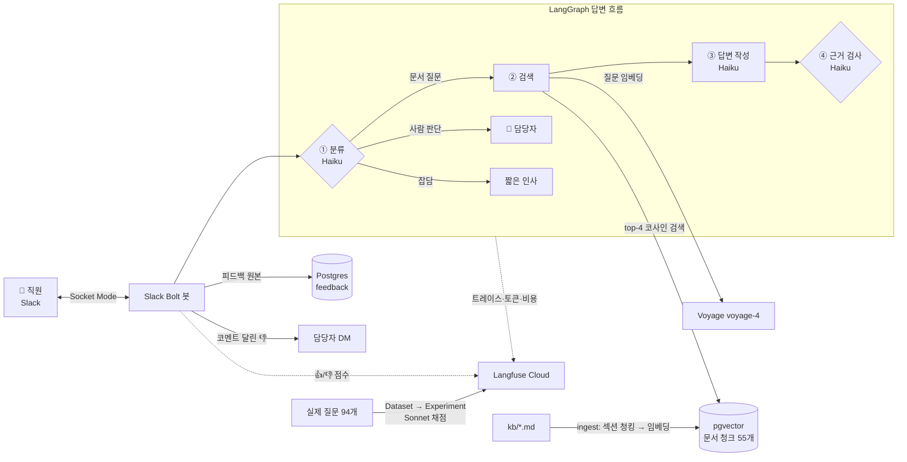

# bnb2 — 사내 문서 기반 슬랙 Q&A 봇

> 직원이 슬랙에 물으면 사내 문서에서 근거를 찾아 답하고 출처를 붙인다. **근거가 없으면 지어내지 않고 "찾지 못했어요"라고 답한다.**
> 답변 품질(정답률·환각률)과 운영 지표(속도·비용·만족도)는 Langfuse로 측정한다.

회사 문서는 공개할 수 없어서, 시연 데이터로 **실제 운영 중인 에어비앤비 숙소의 운영 문서**를 썼다. `kb/` 폴더의 문서만 바꾸면 어떤 회사의 규정·매뉴얼로도 동작한다.

**LangGraph · RAG (Voyage + pgvector) · Claude · Langfuse · Slack Bolt**

---

## 이런 봇이다

```
👤 체크아웃 후 짐 몇 시까지 맡길 수 있어?
🤖 퇴실 후에는 오후 2시 30분까지 짐을 보관해 드릴 수 있습니다. 다만 짐 보관은 체크아웃 당일에만 가능합니다.
   📄 출처: 01_입실_퇴실.md > 퇴실 후 짐 보관
   📄 출처: 01_입실_퇴실.md > 짐 보관 요금과 가능한 날
   [👍 정확해요] [👎 틀렸어요]

👤 근처 맛집 추천해줘
🤖 문서에서 찾지 못했어요. 담당자에게 확인 후 알려드릴게요. @담당자

👤 게스트가 하루 일찍 나간다고 환불해 달래
🤖 🚨 담당자 판단이 필요한 질문이에요. 담당자에게 전달할게요. @담당자
```

## 아키텍처



| 구성 | 선택 | 이유 |
|---|---|---|
| 흐름 | **LangGraph** | 분류 결과에 따라 길이 갈리고(문서 질문 / 사람 판단 / 잡담), 노드마다 상태를 남겨야 한다 |
| LLM | Claude **Haiku 5.5** (답변), **Sonnet 5.5** (채점) | 답변은 빠르고 싸게, 채점은 더 강한 모델로 |
| 임베딩 | Voyage `voyage-4` (1024차원) | Anthropic은 임베딩을 제공하지 않는다. Anthropic 권장 업체 |
| 벡터 DB | **pgvector** (Postgres) | 원문·출처·벡터를 한 표에. 피드백 표도 같은 DB에 둔다 |
| 관찰·평가 | **Langfuse Cloud** | 노드별 트레이스, 데이터셋 실험, 점수, 대시보드. 셀프호스팅은 컨테이너 6개·2.6GB라 Cloud 선택 |
| 슬랙 | Bolt + **Socket Mode** | 공개 서버 없이 로컬에서 양방향 통신 |

## 환각을 막는 구조

LLM에게 "문서에 없으면 지어내지 마"라고 **지시하는 것만으로는 부족했다** (아래 개선 사례 1). 그래서 답을 쓰는 호출과 **검사하는 호출을 분리**했다.

| 단계 | 장치 |
|---|---|
| ③ 답변 | `<문서>` 태그 안의 청크 4개만 보고 답하게 한다. 구조화 출력으로 `answer`와 `sources`만 받는다 |
| ④ 근거 검사 | **별도 Claude 호출**이 두 가지를 판정한다. `grounded`: 답변 내용이 전부 문서에 있나, `direct`: 질문에 직접 답했나. 하나라도 false면 답을 버리고 "찾지 못했어요" |
| 출처 검증 | Claude가 적은 출처 중 **실제로 검색된 청크의 출처만** 붙인다. 출처를 지어내도 나가지 않는다 |
| 사람 판단 | 환불·예약 변경·규칙 예외는 AI가 초안을 쓰지 않고 담당자를 부른다 |

검색은 답이 없어도 항상 가장 가까운 4개를 돌려주고, 유사도 점수로는 "답 있음/없음"을 가를 수 없었다 (답 없는 질문 1등 0.49 vs 답 있는 질문 4등 0.53). 그래서 기준값으로 거르지 않고 ④에서 판단한다 ([3단계](docs/3단계_검색.md)).

## 품질 측정

**시험지**: 에어비앤비 대화 기록에서 뽑은 **실제 게스트 질문 94개 + 호스트가 실제로 보낸 답**. 문서 보강에는 2026년 6월까지의 답만, 시험에는 7월 이후 질문만 써서 **데이터 누수**를 막았다.

**채점** (Langfuse Experiment, 문제마다 Sonnet 1회)

| 점수 | 뜻 |
|---|---|
| `grade` | correct / partial / wrong / abstain — 호스트 실제 답과 비교 |
| `hallucination` | 답에 검색된 문서에 없는 내용이 있나 (정답과 무관) |
| `retrieval_hit` | 검색된 청크 안에 정답 정보가 있었나 |
| `blocked` | 근거 검사 노드가 답을 막았나 |

정답률과 환각률을 **분리**해서 잰다. "틀렸지만 문서엔 근거함"(검색·문서 문제)과 "지어냄"(생성 문제)은 고칠 곳이 다르다.

**결과** (94문제 전체 시험, 채점 지시문 동일 — [자세히](docs/6-3단계_전체_시험_집계.md))

| 지표 | 1차 `baseline` (10-20) | 개선 후 `after-fix` (10-26) | 이전 n8n 봇 |
|---|---|---|---|
| 정답률 | 22.3% | **43.6%** | 36.2% |
| 부분정답률 | 19.1% | 12.8% | 30.9% |
| 오답률 | 11.7% | **3.2%** | 9.6% |
| 보류율 | 46.8% | 40.4% | 23.4% |
| 검색 적중률 | 39.4% | 60.6% | 45.7% |
| 환각률 | 1.1% (1건) | 2.1% (2건) | 측정 안 함 |
| 종합 점수 | 31.9점 | 50.0점 | 51.6점 |

1차 시험은 환각은 거의 막았지만 **너무 보수적**이었다. 보류 44건 중 27건은 문서에 답이 없었고(지식 갭), 10건은 답이 검색됐는데 근거 검사가 막았다(과잉 차단). 오답 11건은 모두 봇이 문서대로 답했는데 문서가 호스트의 과거 답과 달랐다(정책 변경 등).

그래서 오답·보류를 호스트와 하나씩 확인해 **문서 약 10곳과 정답지 25문제를 고치고**, 근거 검사를 "질문의 핵심에 답했으면 통과"로 완화했다. 정답률은 n8n 봇을 넘었고 오답률은 1/3로 줄었다 (26문제 개선, 5문제 악화). 다만 두 변경을 한 번에 넣어서 **각각의 효과는 나누지 못했고**, 완화의 부작용으로 환각이 1건 늘었다.

## 실측 운영 지표 (Langfuse)

| 지표 | 값 |
|---|---|
| 노드별 응답 시간 p50 | 분류 1.2초 · 검색 0.06초 · 답변 1.4초 · 근거 검사 1.4초 |
| 질문 1개 비용 (답변, Haiku 3회) | 약 $0.0006 (1원 미만) |
| 채점 1문제 비용 (Sonnet) | 약 $0.0057 |
| Langfuse 사용량 | 질문 1개 ≈ 17 unit (무료 한도 월 5만) |

병목은 Claude 호출 3번이고, 검색(pgvector)은 무시할 수준이다.

## 개선 사례 — 문제 → 원인 → 수정 → 결과

| # | 문제 | 원인 | 수정 | 결과 |
|---|---|---|---|---|
| 1 | 문서에 답이 없는데 "문서엔 없지만 참고로…" 하고 답함 | 프롬프트 지시를 Claude가 무시 | ④ 근거 검사에 `direct` 판정 추가 | 부분 답변 → "찾지 못했어요". 정상 답변은 그대로 |
| 2 | 진짜 출처가 답변에서 빠질 수 있음 | Claude가 출처를 `[출처: …]` 괄호째 적음 | "포함 여부"로 비교 + 테스트 | 출처 정상 표시 |
| 3 | 대시보드 토큰·비용이 2배 | anthropic SDK 자체 기록이 같이 수집됨 | Langfuse가 만든 기록만 내보내기 | 호출 1회 = 기록 1개 |
| 4 | 같은 질문에 호스트 답이 14시/15시로 다름 | 실제 데이터의 잡음, 정책 변경 | 호스트 확인 후 문서와 정답을 한 시각으로 통일 (현재 15:00) | 봇·시험지·정책 일치 |
| 5 | "현관 비밀번호 어떻게 눌러?" → 부분정답 | 채점 이유에서 **지식 갭** 발견 ("V 버튼"이 문서에 없음) | 문서에 한 줄 추가 | 답에 V 버튼 포함 |
| 6 | "담배 어디서 피워?"에 👎 피드백 | 트레이스를 보니 "흡연 금지"만 있고 **장소 정보가 없음** | 하우스룰 보강 | "찾지 못했어요" → "숙소 밖에서 피워 주세요" |
| 7 | 슬랙 질문이 몰리면 "⚠️ 답변할 수 없어요" | Voyage 무료 한도 분당 3회 | 한도 초과 시 대기 후 재시도, 시험은 질문 전체를 1회로 묶어 임베딩 | 에러 대신 지연 |
| 8 | 청크에 제목을 붙이면 검색이 좋아질 것이라고 가정 | — | 직접 측정 | 본문에 주제가 있는 항목은 **차이 없음** (0.564 vs 0.550). 대비책으로 유지, 효과는 전체 시험으로 측정 예정 |

5·6번은 **시험 채점 이유 / 직원 피드백 → 트레이스 → 문서 보강**의 운영 루프가 실제로 동작한 사례다.

## 피드백 루프

```
슬랙 👍/👎 ─┬─▶ Langfuse 점수 user_feedback → 대시보드 "직원 만족도"
            ├─▶ Postgres feedback 표 (원본 영구 보관, CSV 내보내기)
            └─▶ 코멘트 달린 👎 → 담당자 DM (질문 · 봇 답변 · 코멘트 · 트레이스 링크)
```

Langfuse 무료 플랜은 30일 뒤 기록을 지우므로, 문서 개선의 근거인 피드백 원본은 우리 DB에 둔다.

## 운영 대시보드

Langfuse 는 트레이스를 하나씩 열어야 내용이 보이고, 시험 결과를 한눈에 비교하기 어렵고, 30일 뒤 기록이 지워진다.
그래서 봇이 질문마다 **한 행씩 우리 Postgres 에 기록**하고, 그 표만 읽는 운영 화면을 따로 만들었다 (`uv run bnb2 web`).

| 화면 | 보는 것 |
|---|---|
| 개요 | 질문 수, 문서 질문 해결률, 확인 필요 건수, 👍 비율, 응답 시간, 비용 (이전 기간 대비 증감) · 일별 처리 결과 · 단계별 응답 시간 · 최근 시험 |
| 처리함 | 찾지 못함 · 담당자 호출 · 오류 · 👎 받은 질문만. 처리 상태(미처리 / 문서 보강함 / 무시)와 메모, 정답을 적어 **시험지에 추가**, 문서를 고친 뒤 **다시 돌려보기**. 사이드바에 처리 대기 건수 |
| 대화 | 모든 질문을 한 줄씩. 결과·피드백·경로로 거르고, 누르면 분류 이유 → 검색 문서와 유사도 → 답변 초안 → 근거 검사 판정 → 피드백 → 시간·토큰·비용 |
| 시험 | 점수와 정답·오답·보류·환각·차단율 (n8n 기준선이나 다른 시험 대비), **틀린 이유 자동 분류**(검색·문서 / 과잉 차단 / 답변 생성 / 분류 / 환각 → 고칠 곳), 주제별 결과, 문제별 호스트 답 vs 봇 답 |
| 문서 | 문서 항목마다 검색된 횟수 · 1위 횟수 · 답에 쓰인 횟수, **한 번도 검색되지 않은 항목**, 못 찾은 질문이 몰린 항목, 파일별 쓰임 |

## 실행

```bash
cp .env.example .env          # Anthropic, Voyage, Langfuse, Slack 키 입력
docker compose up -d          # pgvector
uv sync
uv run bnb2 ingest            # kb/ (없으면 kb.example/) → 청크 → 임베딩 → pgvector
uv run bnb2 ask "체크아웃 몇 시까지예요?"   # 노드별 State 변화 보기
uv run bnb2 slack             # 슬랙 봇 (슬랙 앱은 slack-manifest.yml 붙여넣기로 생성)
```

| 명령 | 하는 일 |
|---|---|
| `uv run bnb2 search "질문"` | 검색 결과 top-4와 유사도 |
| `uv run bnb2 graph` | 그래프 구조 (Mermaid) |
| `uv run bnb2 dataset` | 시험지를 Langfuse Dataset으로 등록 (처리함에서 문제를 추가한 뒤에도 다시 실행) |
| `uv run bnb2 eval 이름 [개수]` | 시험 + Sonnet 채점 + 집계 |
| `uv run bnb2 report 이름` | 저장된 결과로 재집계 (API 호출 없음) |
| `uv run bnb2 dashboard` | Langfuse 대시보드를 코드로 생성 |
| `uv run bnb2 feedback [--comments] [--csv]` | 슬랙 피드백 목록 / CSV |
| `uv run bnb2 web` | 운영 대시보드 (http://127.0.0.1:8000): 개요 · 처리함 · 대화 · 시험 · 문서. 처음 한 번 `cd web && npm install && npm run build` |
| `uv run bnb2 backfill` | 대시보드 이전 기록 가져오기 (`data/eval-*.jsonl`, Langfuse 최근 30일) |
| `uv run pytest -q` | 테스트 21개 |

## 구조

```
src/bnb2/
├── ingest.py      # 2단계: 섹션 청킹 → Voyage 임베딩 → pgvector
├── retrieve.py    # 3단계: 질문 임베딩 → top-k 코사인 검색
├── graph.py       # 4단계: LangGraph (State, 노드 6개, 분기)
├── tracing.py     # 5단계: Langfuse 연결, 개인정보 마스킹
├── evaluate.py    # 6단계: Dataset, Experiment, Sonnet 채점, 집계
├── dashboard.py   # 6단계: 대시보드 위젯 9개 (Dashboard as Code)
├── slack.py       # 7·8단계: 슬랙 봇, 👍/👎, 담당자 DM
├── feedback.py    # 8단계: 피드백 원본 보관
├── store.py       # 10단계: 질문 기록·시험 결과 표 (conversations, eval_runs, eval_items)
├── api.py         # 10단계: 운영 대시보드 API (FastAPI)
└── backfill.py    # 10단계: 이전 기록 가져오기
web/               # 10단계: 운영 대시보드 화면 (React + Vite + Tailwind + shadcn/ui + Recharts)
kb.example/        # 공개용 문서 견본 (실제 kb/ 는 주소·와이파이 때문에 git 제외)
docs/              # 단계별 설계·구현 기록
```

## 단계별 기록

설계부터 각 단계의 구현, 결정 이유, 실제로 겪은 문제를 [docs/](docs/)에 남겼다.

[설계](docs/00_설계.md) · [0 뼈대](docs/0단계_프로젝트_뼈대.md) · [1 인프라](docs/1단계_인프라.md) · [2 문서 적재](docs/2단계_문서_적재.md) · [3 검색](docs/3단계_검색.md) · [4 LangGraph](docs/4단계_LangGraph.md) · [5 Langfuse](docs/5단계_Langfuse_트레이싱.md) · [6-1 시험지](docs/6-1단계_시험지_등록.md) · [6-2 채점기](docs/6-2단계_채점기.md) · [6-3 집계](docs/6-3단계_전체_시험_집계.md) · [6-4 대시보드](docs/6-4단계_대시보드.md) · [7 슬랙 봇](docs/7단계_슬랙_봇.md) · [8 피드백](docs/8단계_피드백.md) · [9 마무리](docs/9단계_마무리.md) · [10 운영 대시보드](docs/10단계_운영_대시보드.md)

## 한계와 다음 할 일

- **보류율이 여전히 높다** (40.4% vs n8n 23.4%) — 지어내지 않는 대신 애매하면 "찾지 못했어요"라고 한다. 대부분 문서에 없는 정보라 문서 보강이 필요하다.
- **여러 가지를 한 번에 묻는 질문**에 약하다 — 검색 4개가 한 주제로 쏠린다. 질문을 나눠 검색하는 것이 다음 후보다.
- 문서가 게스트 안내용이라 직원 업무(청소 절차 등) 질문은 대부분 "찾지 못했어요"가 된다. 직원용 매뉴얼을 추가해야 한다.
- 대화 맥락을 쓰지 않는다 (질문 하나씩 처리).
- 봇이 로컬에서 Socket Mode로 돌아서, 컴퓨터가 꺼지면 응답하지 않는다.
- Langfuse 대시보드 API는 아직 unstable 단계다.
