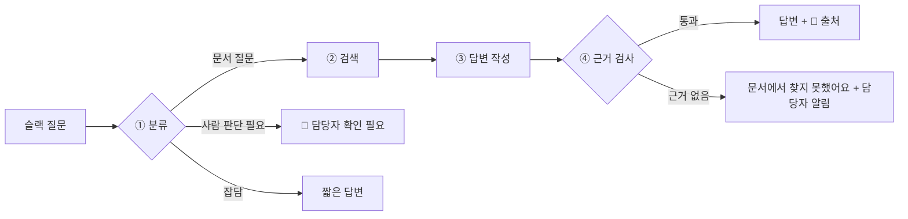

# bnb2 설계

> **사내 문서 기반 슬랙 Q&A 봇.** 직원이 슬랙에 물으면, 사내 문서에서 근거를 찾아 답하고 출처를 붙인다.
> 회사 문서는 공개할 수 없으므로, 시연 데이터로 **실제 운영 중인 숙소의 운영 문서**를 쓴다.
> 문서 폴더만 바꾸면 어느 회사에서든 그대로 쓸 수 있는 구조를 목표로 한다.

## 결정 사항

| 항목 | 결정 | 이유 |
|---|---|---|
| 질문하는 사람 | 직원 (공동호스트, 청소 담당자) | 사내 봇과 같은 형태. 간결한 답변 + 📄 출처 |
| 언어 / 도구 | Python 3.12 + uv | LangGraph·Langfuse 예제가 가장 많음. `uv.lock`으로 환경 재현 |
| LLM | 답변 `claude-haiku-5-5`, 채점 `claude-sonnet-5-5` | 이전 버전(`bnb`, n8n)과 같은 모델 → 공정 비교 |
| 임베딩 | Voyage `voyage-4` | Anthropic은 임베딩을 제공하지 않음. Anthropic 권장 업체 |
| 벡터 DB | pgvector (Langfuse DB와 별도) | 실무 구성. Langfuse 업그레이드와 섞이지 않게 분리 |
| 청킹 | `##` 섹션 하나 = 청크 하나, 오버랩 없음 | 문서가 이미 주제별로 짧게 나뉘어 있어 문장이 잘릴 일이 없음 |
| 흐름 | LangGraph: 분류 → 검색 → 답변 → 근거 검사 | 근거가 없으면 지어내지 않고 "문서에서 찾지 못했어요" |
| 분류 | 문서 질문 / 사람 판단 필요 / 잡담 | `bnb`에서 검증된 기준. 비교 가능 |
| 관찰 | Langfuse Cloud 무료 플랜 (JP 리전), 개인정보 마스킹 후 기록 | 셀프호스팅은 컨테이너 6개·약 2.6GB 필요 → 가벼운 Cloud 선택. 무료 한도 월 5만 unit, 보관 30일 |
| 평가 | 실제 질문 94개 + 실제 호스트 답변을 Langfuse Dataset으로 | 목표: 이전 버전 정답률 36% 넘기기 |
| 슬랙 | Slack Bolt + Socket Mode | 공개 서버 없이 로컬에서 양방향 통신 |

## 답변 흐름

## 지표

| 지표 | 정의 |
|---|---|
| 정답률 | 채점 모델이 실제 호스트 답과 같다고 판정한 비율 (`correct`) |
| 부분정답률 | 일부만 맞음 (`partial`) |
| 오답률 | 틀림 (`wrong`) |
| 보류율 | "모르겠다"고 사람에게 넘김 (`abstain`) — 오답과 구분 |
| 환각률 | 정답과 무관하게, 답변 속 주장이 **검색된 문서에 근거가 없는** 비율 |
| 검색 적중률 | 검색된 청크 안에 정답 근거가 있었는지 |

환각률을 정답률과 분리하는 이유: "틀렸지만 문서에 근거함"은 **검색·문서 문제**, "지어냄"은 **생성 문제**라 고칠 곳이 다르다.

## 단계

각 단계가 끝나면 `docs/N단계_*.md`(설명) + 직접 확인할 명령어를 남기고, 승인 후 커밋한다.

| 단계 | 내용 |
|---|---|
| 0 | 프로젝트 뼈대 (git, uv, 폴더, `.env.example`) |
| 1 | 인프라: Docker로 pgvector + Langfuse Cloud 연결 |
| 2 | 문서 적재: 섹션 청킹 → Voyage 임베딩 → pgvector |
| 3 | 검색: 질문 → top-k 청크 |
| 4 | LangGraph: State, 노드 4개, 분기 |
| 5 | Langfuse 트레이싱 + 개인정보 마스킹 |
| 6 | 평가: 94문제 Dataset → 실험 → 자동 채점 → 대시보드 |
| 7 | 슬랙 봇 (Socket Mode) |
| 8 | 👍/👎 피드백 → Langfuse 점수 |
| 9 | 개선 실험, README, 아키텍처 그림 |
