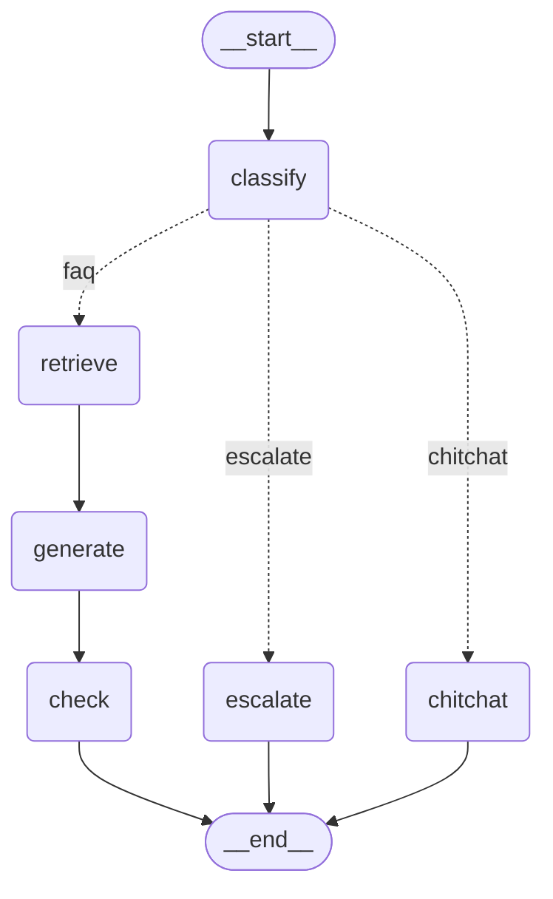

# 4단계: LangGraph (분류 → 검색 → 답변 → 근거 검사)

> 3단계 검색에 Claude를 붙여 **질문 하나를 끝까지 처리하는 흐름**을 LangGraph로 만들었다.
> 노드마다 State(상태 상자)의 칸을 하나씩 채우고, 분류 결과에 따라 길이 갈린다.

## 그래프 (`uv run bnb2 graph` 출력)


실선(`-->`)은 항상 가는 길이고, 점선(`-.->`)은 조건에 따라 하나만 가는 길(조건부 분기)이다.

## 한 일

| 파일 | 설명 |
|---|---|
| `src/bnb2/graph.py` | State, 노드 6개, 분기, 그래프 조립, 실행 출력 |
| `src/bnb2/__init__.py` | `uv run bnb2 ask "질문"`, `uv run bnb2 graph` 명령 추가 |
| `tests/test_graph.py` | 분기 규칙, 빈 답 처리, 출처 검증 테스트 |
| 추가 라이브러리 | `langgraph` 1.2 (흐름), `langchain-anthropic` 1.7 (Claude 호출) |

## State: 노드들이 돌려 쓰는 상태 상자

```python
class State(TypedDict, total=False):
    question: str            # 입력
    intent: str              # ① classify  faq / escalate / chitchat
    reason: str              # ① classify  분류 이유
    chunks: list[dict]       # ② retrieve  검색된 청크 4개
    answer: str              # ③ generate  답변 ("" = 문서에 없음)
    sources: list[str]       # ③ generate  답에 쓴 출처
    grounded: bool           # ④ check     답변 내용이 전부 문서에 있나
    direct: bool             # ④ check     질문에 직접 답했나
    check_reason: str        # ④ check     판정 이유
    reply: str               # 최종 답변 (슬랙에 보낼 글)
```

**노드는 State 전체를 받고, 자기가 바꿀 칸만 dict로 돌려준다.** LangGraph가 그걸 State에 합친다. 예: `retrieve`는 `{"chunks": [...]}`만 돌려준다.

`total=False`인 이유는 처음에는 `question`만 있고 나머지 칸이 노드를 거치며 채워지기 때문이다.

## 노드 6개

| 노드 | Claude 호출 | 읽는 칸 | 쓰는 칸 | 하는 일 |
|---|---|---|---|---|
| `classify` | 1회 | question | intent, reason | 질문을 3종류로 분류 |
| `retrieve` | 0 (Voyage 1회) | question | chunks | 3단계 `search()` 그대로 호출 |
| `generate` | 1회 | question, chunks | answer, sources | 청크만 보고 답변. 없으면 빈 답 |
| `check` | 0~1회 | question, answer, chunks, sources | grounded, direct, check_reason, reply | 근거·직접 답변 여부 검사 → 최종 답 결정 |
| `escalate` | 0 | – | reply | 고정 문구 "🚨 담당자 판단이 필요한 질문이에요" |
| `chitchat` | 1회 | question | reply | 한 문장 인사 |

### 분기 (`route`)
```python
def route(state):
    return {"faq": "retrieve", "escalate": "escalate", "chitchat": "chitchat"}[state["intent"]]
```
`add_conditional_edges("classify", route, ...)`로 연결한다. ① 분류가 쓴 `intent` 값을 보고 다음 노드를 고른다.

### 프롬프트

**① classify**
```
너는 숙소 운영팀의 사내 도우미야. 직원(공동호스트, 청소 담당자)의 질문을 분류해.
- faq: 숙소 문서(입실·퇴실, 와이파이, 비품, 하우스룰, 주차·주변 등)로 답할 수 있는 정보 질문
- escalate: 사람이 판단해야 하는 일. 환불, 불만·클레임, 파손, 예약 변경, 인원 추가, 규칙 예외 허락, 호스트가 직접 움직여야 하는 요청
- chitchat: 인사, 감사, 잡담
```
분류 기준은 기존 `bnb`에서 검증된 기준을 직원용으로 옮긴 것이다.

**③ generate**: 시스템 지시 + `<문서>[출처: ...] 청크 4개</문서>` + `<질문>`
```
- <문서>에 있는 내용만 써. 상식이나 추측으로 채우지 마.
- <문서>에 질문에 대한 직접적인 답이 없으면 answer 를 빈 문자열로 둬.
  "문서에는 없지만 참고로…"처럼 없다는 말이나 관련 정보로 대신 채우지 마.
- 직원에게 하는 말이니 1~3문장으로 간결하게, 존댓말로.
- 답에 쓴 문서의 [출처]를 sources 에 그대로 적어.
```

**④ check**: 별도 호출이다. 답변을 쓴 호출과 분리해서 "제3자"처럼 검사한다.
```
너는 사실 검증 담당이야. 두 가지를 판정해.
- grounded: <답변>의 모든 내용이 <문서>에 실제로 적혀 있나. 문서에 없는 숫자·조건·약속이 하나라도 있으면 false.
- direct: <답변>이 <질문>에 직접 답하나. "문서에 없다"고 하거나 관련 정보만 늘어놓으면 false.
```
`grounded`와 `direct`가 **둘 다 true일 때만** 답변을 보내고, 하나라도 false면 "문서에서 찾지 못했어요"로 바꾼다.

## 설계 결정

| 결정 | 이유 |
|---|---|
| **구조화 출력** `with_structured_output(Pydantic 모델)` | Claude가 정해진 모양의 JSON(`intent`, `answer`, `grounded` 등)만 돌려주게 강제한다. 글을 파싱하다 깨질 일이 없다 |
| 모델 `claude-haiku-5-5`, `max_tokens=1024` | 기존 `bnb`와 같은 모델이라 공정하게 비교할 수 있다 |
| `temperature` 설정 없음 | 이 모델은 `temperature`를 받지 않는다 (400 오류: deprecated). 처음엔 0으로 넣었다가 뺐다 |
| 빈 답이면 check에서 Claude 호출 생략 | 답이 없는데 "근거 있나" 물을 필요가 없다. 비용과 시간 절약 |
| **출처 검증** `known_sources` | **실제로 검색된 청크의 출처 중** Claude가 적은 것만 남긴다. 출처를 지어내도 슬랙에 나가지 않는다. Claude가 `[출처: …]`처럼 괄호째 적는 경우가 있어 "포함 여부"로 비교한다 |
| **직접 답변 검사** `direct` | 문서에 답이 없을 때 "문서엔 없고, 참고로 …" 같은 부분 답변을 막는다 (아래 "변경 기록") |
| escalate는 Claude 없이 고정 문구 | 사람이 판단할 일에 AI 초안을 주면 오히려 위험하다 (환불 약속 등) |
| 근거 없음 → 답변을 버리고 `NOT_FOUND` | Q9 결정: 환각이 의심되면 "모르겠다"로 바꾼다 |

## 실제 실행 결과 (`uv run bnb2 ask "..."`)

### ① 직접 답이 있는 질문: "수건 더 있어요?"
```
── classify ──   intent: faq
── retrieve ──   [0.614] 05_객실_구성과_비품.md > 수건 ...
── generate ──   answer: 기본 사이즈 수건은 16장(1박일 경우 8장)과 큰 사이즈 수건을 인원수만큼 준비해 드립니다. ...
── check ──      grounded: True   direct: True
                 reply: (위 답변)
                        📄 출처: 05_객실_구성과_비품.md > 수건
```

### ② 문서에 직접 답이 없는 질문: "근처에 맛집 추천해줘"
```
── classify ──   intent: faq
── retrieve ──   [0.492] 06_주차와_주변.md > 카페 ...
── generate ──   answer: 문서에는 근처 맛집에 대한 정보가 없습니다. 주변 카페(coworker)와 편의점·올리브영, ... 정보만 확인됩니다.
── check ──      grounded: True   direct: False
                 check_reason: ... 질문인 맛집 추천에 직접 답하지 않고 '문서에 없다'고만 말하고 관련 정보만 나열했다.
                 reply: 문서에서 찾지 못했어요. 담당자에게 확인 후 알려드릴게요.
```
"퇴실 후 수건 몇 장 채워둬야 해?"도 같은 방식으로 처리된다. 문서에는 게스트용 수건 수만 있고 직원이 채울 장수는 없어서 `direct: False`가 나오고, 답은 "찾지 못했어요"로 바뀐다.

### ③ 사람 판단: "게스트가 하루 일찍 나간다고 환불해 달래요"
```
── classify ──   intent: escalate  (환불 여부와 금액은 사람이 판단해야 한다)
── escalate ──   reply: 🚨 담당자 판단이 필요한 질문이에요. 담당자에게 전달할게요.
```
검색과 Claude 답변 없이 바로 끝난다.

### ④ 잡담: "고마워!"
```
── classify ──   intent: chitchat
── chitchat ──   reply: 천만에요! 필요한 게 또 있으면 편하게 말씀해 주세요.
```

## 변경 기록: 부분 답변 → "찾지 못했어요"

처음 실행에서 Claude는 문서에 직접 답이 없을 때 빈 답 대신 **"문서에는 OO이 없습니다. 참고로 …"**라고 답했다. 지어낸 내용이 아니라서 근거 검사(grounded)를 통과해 그대로 나갔다.

결정: **문서에 직접적인 답이 없으면 "찾지 못했어요"만 보낸다.**

| 시도 | 결과 |
|---|---|
| ③ 답변 프롬프트에 "없다는 말이나 관련 정보로 채우지 마" 추가 | ❌ **Claude가 여전히 부분 답변을 썼다.** 프롬프트만으로는 막히지 않았다 |
| ④ 근거 검사에 `direct`(질문에 직접 답했나) 판정 추가 | ✅ 부분 답변을 `direct: False`로 잡아 "찾지 못했어요"로 바꿨다. 정상 답변은 `direct: True`로 통과했다 |

**교훈**: 지시를 한 번 하는 것만으로는 LLM 행동이 보장되지 않는다. **별도 검사 단계**가 있어야 확실히 막을 수 있다. 근거 검사 노드를 따로 둔 설계가 여기서 효과를 냈다.

이 과정에서 버그도 하나 찾았다. Claude가 출처를 `[출처: 07_퇴실_안내.md > ...]`처럼 괄호째 적어서 `known_sources`가 진짜 출처를 버릴 수 있었다. "포함 여부" 비교로 고치고 테스트를 추가했다.

## 그 밖의 발견

1. **kb는 게스트용 문서다**: "퇴실 후 몇 장 채워야 하나"(직원 업무)는 문서에 없다. 직원용 봇으로 쓰려면 청소 매뉴얼 같은 직원용 문서가 더 필요하다.
2. **check_reason에 찌꺼기 글자**: 판정 이유 끝에 `</reason></invoke>` 같은 글자가 섞여 나온 적이 있다. 구조화 출력의 드문 오류로, 슬랙으로 나가는 `reply`에는 영향이 없다. 6단계에서 자주 나오면 처리한다.

## 🔍 직접 확인

아래 네 가지 질문을 직접 실행해 확인할 수 있다.
```bash
uv run bnb2 ask "퇴실 후 수건 몇 장 채워둬야 해?"
```
```bash
uv run bnb2 ask "근처에 맛집 추천해줘"
```
```bash
uv run bnb2 ask "게스트가 하루 일찍 나간다고 환불해 달래요"
```
```bash
uv run bnb2 ask "고마워!"
```
```bash
uv run bnb2 graph
```
```bash
uv run pytest -q
```

⚠️ Voyage 무료 한도는 분당 3회다. 문서 질문(faq)을 1분에 4번 넘게 하면 검색에서 오류가 난다.
